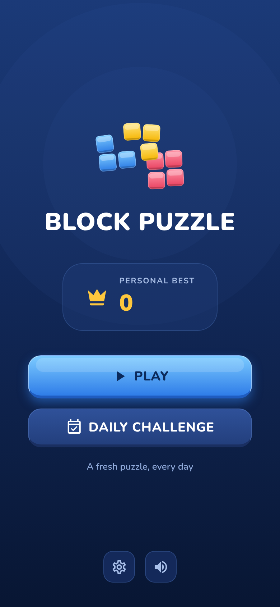
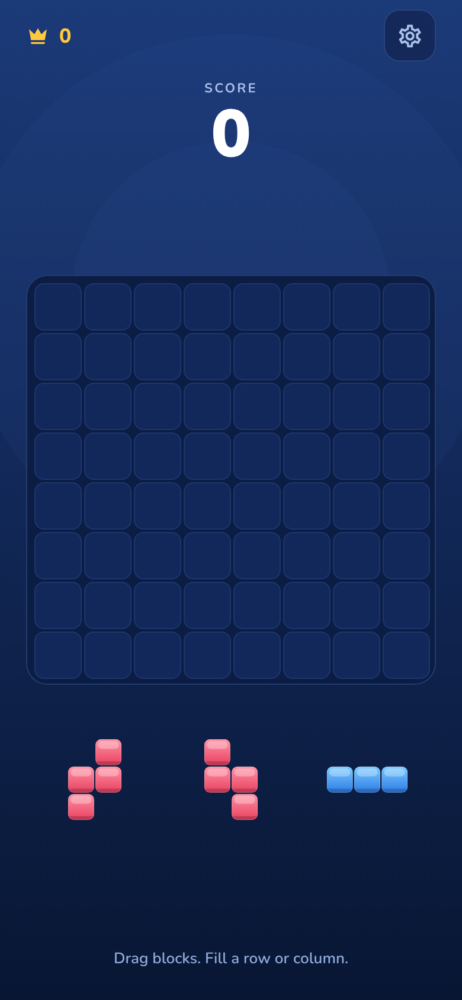

# Block Puzzle

[](https://github.com/helenyildirim/block-puzzle/actions/workflows/ci.yml)
[](LICENSE)

A block puzzle game built with Expo, React Native and TypeScript. Drag three pieces at a time onto an 8x8 board and clear full rows and columns. It has no ads and no purchases.

<p>
  
  
</p>

## Features

- Classic mode and a Daily Challenge
- Combo scoring with streak multipliers up to x4 and a +300 bonus for emptying the board
- Sound effects, music and haptic feedback
- Saved progress and personal best
- Screen reader labels for buttons and switches

## Scoring

Each placed piece scores one point per square. Clearing lines scores 10, 20, 60, 120, 200 or 300 for 1 to 6+ lines. The streak multiplier grows with consecutive clears and resets after three moves without one.

## Project structure

- `src/app/` screens, using Expo Router
- `src/game/` game logic: pieces, scoring, piece generation and the daily challenge
- `src/components/` board, blocks, drag-and-drop area and overlays
- `src/state/` app state and saved data
- `scripts/` engine tests and the icon and sound generators

## Run it

```
npm install
npx expo start
```

Scan the QR code with Expo Go.

## Checks

```
npm run typecheck
npm run lint
npm test
```

`npm test` covers the game logic and simulates 300 full games.

## Build

```
npx eas-cli@latest build --platform android --profile preview
```

## Stack

Expo SDK 57, Expo Router, React Native, TypeScript, expo-audio, AsyncStorage

## License

MIT
